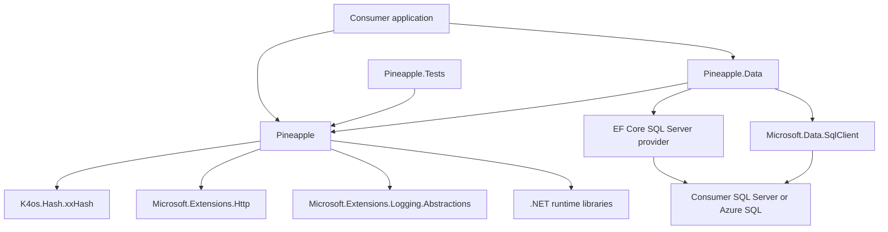

# Pineapple architecture

- Status: Implemented locally; original design received five Goldfish stages, and the resulting implementation received a fresh source review. Local verification is recorded below; hosted CI and publication remain separate.
- Date: 2026-11-02.
- Scope: The full repository, including both libraries, their dependencies, tests, documentation, and release process.

## Overview

Pineapple provides reusable C# utilities targeting .NET 8, 9, 10, and 11 RC. The required compatibility scope is .NET 8, 9, 10, and 11, including successive current .NET releases rather than only LTS releases. It is a library, not a hosted service. Applications call its utilities directly and own their configuration, dependency injection container, network destinations, credentials, and deployment.

The repository produces two NuGet packages. `Pineapple` contains general utilities and HTTP integration. `Pineapple.Data` adds SQL Server and Entity Framework Core helpers and references the core project. Consumers that need only core utilities should not inherit the SQL client or EF Core dependencies.

This document records the architecture implemented today, defines the contracts that modernization must preserve, and identifies gaps requiring follow-up. Descriptions of intended behavior do not establish that the current implementation satisfies that behavior.

## The problem

Applications repeatedly need argument validation, compact identifiers, reproducible hashes, concurrency tokens, request pacing, timing, cleanup, and connectivity checks. Pineapple centralizes those operations behind small APIs.

Modernizing the library requires more than replacing packages with newer names. Consumers may persist hash values, depend on encoded identifiers, and rely on public types and exception behavior. A dependency change that silently changes those contracts can be worse than retaining a functioning dependency. Conversely, an unchanged API can still contain correctness or security defects.

## Goals

- Keep general utilities usable without SQL Server or EF Core dependencies.
- Support .NET 8, 9, 10, and 11 with explicit build, test, package, and consumer-restore coverage, and preserve existing public contracts unless a breaking change is explicitly agreed.
- Preserve K4os xxHash and repeatable, persistable `Pineapple.Common.HashCode` results across application instances for the same supported inputs and encoding.
- Make dependency decisions from actual usage, compatibility, maintenance, and security evidence. Package age alone is insufficient grounds for removal.
- Define resource ownership, scope lifetimes, error behavior, and the limits of local rate limiting and connectivity checks.
- Verify both target frameworks and the published package contents before release.
- Record implementation gaps separately from architectural guarantees.

## Non-goals

- Replacing K4os xxHash, switching persisted hashes to `System.HashCode`, or changing the existing hash representation.
- Adding OWIN, ASP.NET hosting, a web API, a database owned by Pineapple, or an application deployment layer.
- Providing distributed rate limiting, durable queues, cryptographic hashing, or globally unique 32-bit hashes.
- Renaming existing public types, including the `ResourceGoverner` spelling, as incidental cleanup.
- Implementing the follow-up changes while writing this document.

## Technical plan and architecture

### Package and runtime boundaries

`Pineapple.Tests` tests core behavior and launches a framework-matched hash probe. `Pineapple.Data.Tests` references the data project, validates metadata models without a server, checks loopback TCP reachability, and runs an explicitly configured SQL Server integration fixture.

| Area | Source | Responsibility and boundary |
| --- | --- | --- |
| Core contracts | [Pineapple/Common](Pineapple/Common) | Preconditions, cleanup, `ShortGuid`, GUID helpers, and deterministic hashing. |
| Concurrency token | [RowVersion](Pineapple/Data/RowVersion.cs) | SQL rowversion representation and ordering; ships in the core package despite its namespace. |
| Threading | [Pineapple/Threading](Pineapple/Threading) | Local pacing, governors, operation tracking, timeouts, delays, and synchronization scopes. |
| Diagnostics | [Pineapple/Diagnostics](Pineapple/Diagnostics) | Scoped timing, logging, and console color handling. |
| Networking | [Pineapple/Networking](Pineapple/Networking) | Brotli response decoding and HTTP client registration extensions. |
| Health | [Check](Pineapple/Health/Check.cs) | Process lookup, TCP reachability, and URL response checks. |
| SQL helpers | [Pineapple.Data](Pineapple.Data) | SqlClient integration and EF queries over `INFORMATION_SCHEMA`. |
| Validation | [Pineapple.Tests](Pineapple.Tests) | MSTest tests using Shouldly where applicable. |

### Identifiers, values, and persisted hashes

`ShortGuid` encodes the bytes of a GUID as URL-safe Base64 without padding, producing a 22-character representation. Consumers can convert between `Guid`, strings, and `ShortGuid`. This is an encoding of an identifier, not an encryption mechanism or a separate source of uniqueness. Decoding normalizes unused Base64 padding bits so previously accepted aliases retain their GUID values under .NET 11 stricter validation; canonical encoding is unchanged. Compatibility includes byte order, alphabet, padding rules, and parsing behavior.

`RowVersion` stores an unsigned 64-bit value and converts SQL rowversion byte arrays using explicit most-significant-byte-first ordering. Its comparisons implement ordering of concurrency tokens; it is not a wall-clock timestamp. The token remains in `Pineapple` so callers do not need an EF provider merely to represent a value.

`Pineapple.Common.HashCode` builds a 32-bit xxHash using `K4os.Hash.xxHash.XXH32`. `HashCodeHelper` converts supported values to bytes and feeds them to the hasher. Strings use UTF-8, dates use ticks, and many numeric types use `BitConverter`. The public static combination methods and mutable instance API share this conversion layer.

The owner requires persistable hashes across application instances. Retain K4os and the existing algorithm, seed behavior, input order, conversions, and signed integer result. Do not substitute the process-randomized `System.HashCode`. No alternative hash dependency is proposed here.

This contract needs fixed expected-value tests, not only comparisons of two executions of the same implementation. Existing conversion rules also limit the scope of the guarantee: `BitConverter` depends on machine byte order, concatenated strings do not carry field boundaries, and different typed values can yield the same bytes. A 32-bit hash can collide. Consumers must retain or compare the original identity when collisions matter. Do not claim cryptographic integrity, universal cross-platform serialization, or collision-free identity.

Changing the input encoding to solve those ambiguities would change persisted values. Any such future format needs an explicitly versioned contract and migration design; it is outside this design's modernization scope.

### Preconditions and cleanup

Preconditions check inputs at API boundaries and throw argument-related exceptions. Exception types and parameter names are observable behavior and belong in compatibility tests.

Cleanup helpers deliberately suppress exceptions from cleanup actions. They are appropriate when cleanup must not replace an earlier failure. They must not be used as a general success signal for operations whose failures callers need to observe.

### Pacing, resource governors, and timing

`RateLimiterScope` measures the duration of a caller-owned scope and delays disposal to achieve a minimum per-call duration. Synchronous disposal blocks; asynchronous disposal awaits the remaining delay. Separate instances do not establish a shared global quota.

`SafeRateLimiterScope` shares a semaphore by token in a process-local registry. Construction acquires synchronously; disposal may release on a different thread. Active users of a token must agree on rate, otherwise construction throws. Reference accounting includes waiting callers and retires the registry entry after the final caller leaves. Timing starts after acquisition; disposal pads the remaining scope duration and releases exactly once. This API has no cancellation parameter and promises no FIFO fairness.

`SemaphoreRateLimiterScope` limits concurrent operation scopes, not calls per minute. Its semaphore starts with `maxCalls` permits; each operation releases once. Owner disposal rejects new acquisitions, cancels waiting acquisitions with `ObjectDisposedException`, and defers semaphore destruction until already admitted scopes drain. The public scope interface supports synchronous and asynchronous disposal.

`ResourceGoverner` spaces operation starts using monotonic `Stopwatch` deadlines under the operation lock. The first acquisition is immediate; subsequent starts are separated by at least that interval, without accumulated idle-time bursts or FIFO guarantees. Admitted operations may execute concurrently. It composes `Operations`, `Operation`, `CallsPerMinute`, and `AccurateTimeout`. The operation scope marks completion on disposal. Governing state belongs to a governor instance, so consumers must share an instance when they intend callers to share a limit.

These mechanisms run inside one application process. They do not coordinate limits across replicas, machines, or separately constructed governors. Operation counts and averages are diagnostic values, not billing records or durable telemetry. `TotalCount` counts starts, `TotalTime` sums completed durations, and `AverageTime` averages completed operations or returns zero when none have completed. Completion updates accounting once under the owner lock; admission uses monotonic deadlines independently of the diagnostic retention window. The scavenger starts with operation tracking and is disposed with the governor. Reported rates use ordered operation-start timestamps: N starts span N−1 intervals. Equal timestamps have no measurable rate and report NaN; reads are synchronized. These UTC diagnostic estimates do not drive monotonic admission.

`AccurateTimeout` uses `Stopwatch`; `SimpleTimeout` and parts of the governor use wall-clock time. The class named `ExponentialWait` currently calculates a power of the attempt count, rather than a conventional exponential series. Preserve current behavior until a deliberate change defines timing, cancellation, overflow, and compatibility requirements.

### HTTP integration and health checks

`BrotliCompressionHandler` is a delegating HTTP handler. It checks response content encoding, decompresses Brotli content into a memory buffer, replaces the content stream, and copies headers except content encoding and content length. It forwards cancellation to its asynchronous network and stream operations. The default decoded-size limit is 64 MiB and can be changed through the positive-byte-limit constructor. Crossing it throws `HttpRequestException`; failures and cancellation dispose the received response and temporary buffer. This remains a buffered decoder, and callers must bound concurrent responses to control process-wide memory.

`HttpClientBuildExtensions` registers the handler with `IServiceCollection` and `IHttpClientBuilder`. This is an actual use of `Microsoft.Extensions.Http`, so that package must remain unless the public integration API is deliberately changed. These are .NET HTTP client extensions, not OWIN middleware.

The health helper owns a static reusable `HttpClient`. Its URL check sends a synchronous GET with a per-call cancellation source and returns true only for HTTP 200. TCP checks attempt a connection; process checks search local processes. These results answer narrow reachability questions and do not establish application readiness, authentication success, or dependency correctness.

Consumers own destination validation and credentials. Pineapple does not turn arbitrary user-supplied URLs or connection strings into trusted inputs.

### SQL and EF Core

`Pineapple.Data` depends on modern `Microsoft.Data.SqlClient`, not `System.Data.SqlClient`. It uses stable EF Core providers: 8.0.33 for .NET 8, 9.0.22 for .NET 9, and 10.0.14 for .NET 10 and 11 RC. Keeping EF Core 10 on the .NET 11 target avoids prerelease production dependencies until EF Core 11 GA.

`InformationSchemaContext` accepts a connection string, configures SQL Server when options are not already configured, and requests no-tracking queries. It exposes tables, columns, key columns, and constraints. The library intends metadata inspection, not schema migration or ownership of a consumer's business tables. No-tracking behavior alone does not enforce database read-only permissions.

All four entities have explicit `INFORMATION_SCHEMA` view mappings and composite keys based on their identifying columns. The stale EF 2.2.2 annotation has been removed. Model-only tests verify all query mappings; SQL integration creates a uniquely named table and asserts table, column, primary-key, and constraint rows before dropping the fixture. Parallel framework fixtures serialize catalog DDL and reads using a bounded SQL application lock on an unpooled session.

`IsSqlServerAvailable` reports TCP reachability, not authenticated SQL readiness. It understands `tcp:`, defaults to port 1433, accepts an explicit port, rejects invalid port values, and returns false after three failed attempts. TCP connection attempts are bounded to five seconds each. Named-instance discovery is not implemented. Callers needing authenticated readiness must open a SQL connection and execute their own readiness query.

### Dependency policy

Package versions are centralized in [Directory.Packages.props](Directory.Packages.props). Shared build metadata is in [Directory.Build.props](Directory.Build.props); individual project files declare which packages they use.

- Retain K4os for the persisted-hash contract. A replacement is explicitly excluded.
- Retain the HTTP and logging abstractions used by public integration APIs and diagnostics.
- Keep EF Core and SqlClient confined to `Pineapple.Data`.
- Audit direct and transitive packages for known vulnerabilities and deprecation; do not infer either from an old release date.
- Prefer compatible stable patches. Do not introduce preview dependencies or change supported framework targets as part of routine updates.
- No OWIN package appeared in the restored direct or transitive graphs inspected during this session. There is no OWIN integration requirement.

The dependency audit performed on 2026-11-02 reported vulnerable transitive `System.Security.Cryptography.Pkcs` versions through SqlClient, associated with [GHSA-846f-f764-76mx](https://github.com/advisories/GHSA-846f-f764-76mx) and [GHSA-2fmv-rv2c-59x7](https://github.com/advisories/GHSA-2fmv-rv2c-59x7). No dependency fix was applied. Re-run the audit when implementing; package feed and advisory state can change.

### Build, distribution, and documentation

[global.json](global.json) selects .NET SDK 11.0.100-rc.3.26522.148 with feature-band roll-forward and Microsoft.Testing.Platform. Both libraries, both test projects, and the hash probe target .NET 8, 9, 10, and 11.

[CI](.github/workflows/ci.yml) restores, builds, and tests on Linux and Windows. It also packs on Linux. [Release](.github/workflows/release.yml) runs from version tags, verifies the commit belongs to main and the tag matches the package version, tests, packs, logs into NuGet through Trusted Publishing, pushes packages, and creates a GitHub release.

The documentation site lives in [docs](docs) and has a separate [Pages workflow](.github/workflows/pages.yml). Package README content, XML documentation, release notes, and site guides should describe the same contracts. SourceLink and deterministic build settings support tracing a package back to source; they do not prove behavioral correctness.

### Required .NET compatibility matrix

The owner requires compatibility across .NET 8, 9, 10, and 11. Project declarations and CI now cover `net8.0;net9.0;net10.0;net11.0`. A newer application may consume a compatible older package asset, but restore compatibility alone does not prove runtime behavior.

| Version | Current explicit target | Required acceptance |
| --- | --- | --- |
| .NET 8 | Yes | Build, test, pack, and temporary-consumer validation. Retain compatibility when Microsoft support ends. |
| .NET 9 | Yes | Add explicit framework coverage and the same acceptance checks; do not omit STS releases. |
| .NET 10 | Yes | Build, test, pack, and temporary-consumer validation. |
| .NET 11 | Yes | Add explicit coverage using the available release-candidate SDK/runtime now; repeat acceptance with the stable release. |

The intended framework list for the two libraries and tests is `net8.0;net9.0;net10.0;net11.0`. EF provider versions are pinned above and resolved separately for each target. Do not assume that an arbitrary provider major is compatible merely because the framework is newer. Keep K4os and the existing hash representation across the entire matrix.

As verified on 2026-11-02, [.NET 11 is a release candidate](https://learn.microsoft.com/en-us/dotnet/core/whats-new/dotnet-11/overview), with [general availability scheduled for November 10, 2026](https://github.com/dotnet/core/blob/main/release-notes/11.0/README.md). [.NET 8 and 9 reach Microsoft end of support on that date](https://devblogs.microsoft.com/dotnet/dotnet-8-9-end-of-support/). Microsoft servicing status must be distinguished from Pineapple compatibility: retain the requested 8/9 coverage, while documenting the absence of future Microsoft runtime fixes after end of support. Keep prerelease SDK/runtime validation identifiable until .NET 11 is stable.

For every framework, test fixed hash results, cross-process hashing, identifiers, concurrency-token conversions, scoped resource behavior, HTTP integration, and SQL integration where applicable. Exercise Linux and Windows, and inspect the resulting NuGet dependency groups. Install the required runtimes rather than letting tests silently roll forward to a different major. Local verification uses an isolated .NET 11 RC SDK with installed runtimes 8.0.33, 9.0.22, 10.0.14, and 11 RC3. Published-package consumer checks also execute on each matching runtime.

For future .NET majors, add coverage during release-candidate testing and verify stable coverage at release. A future runtime is not supported merely because its framework name was added to a project file.

## Critical user journeys

### Persist and later recompute a hash

- Given: A consumer uses the supported input types and the established byte encoding.
- When: It hashes the same ordered values in a separately started application instance.
- Then: It obtains the same signed 32-bit value; a compatible package update preserves established fixed vectors. The consumer handles collisions separately.

### Install core utilities without a database stack

- Given: An application needs identifiers, validation, hashing, or local pacing.
- When: It installs `Pineapple` alone.
- Then: SQL Server and EF Core are not required by that package's dependency graph.

### Pace calls to a shared dependency

- Given: Callers use the same governor instance in one process.
- When: They acquire and dispose operation scopes around downstream calls.
- Then: The governor applies its documented admission policy and releases scope state. Exceptions, disposal, and waiting must not leave callers permanently blocked. Cross-process quotas remain the application's responsibility.

### Inspect SQL metadata

- Given: An application has a valid connection string and sufficient metadata permissions.
- When: It initializes `InformationSchemaContext` and queries its exposed metadata collections.
- Then: EF initializes the model and queries the intended `INFORMATION_SCHEMA` objects on each supported target. The local SQL integration fixture exercises this journey on every target. Hosted CI remains separate validation.

### Publish a compatible package

- Given: A tested main-branch commit has a matching version tag.
- When: The release workflow runs.
- Then: Both NuGet packages are built from that source, with the expected target assets and dependency groups. Successful local tests alone do not establish a successful publish or consumer restore.

## Alternatives considered

### Replace K4os while modernizing dependencies

Rejected by the owner. Persisted hashes are a compatibility requirement, and this project will retain K4os. A package's age does not override that requirement.

### Use `System.HashCode` for persisted values

Rejected because its per-process randomization conflicts with the required cross-instance behavior. Its suitability for ordinary in-process hash tables does not make it a persisted identifier format.

### Remove the HTTP extension package as unused

Rejected after checking `Networking/HttpFactory.cs`: the public builder overloads use it. Removal would require an intentional API change.

### Combine core and SQL helpers into one package

Not adopted. The existing split lets consumers use core utilities without restoring SQL and EF dependencies. No requirement justifies changing that boundary.

### Replace all local limiters with a new framework

Deferred. Rate enforcement, disposal semantics, fairness, shared keys, and cancellation differ between implementations. A blanket replacement would introduce behavioral decisions beyond dependency maintenance.

## Non-functional requirements

- Compatibility: Preserve public signatures and established encodings. Treat changed persisted hash output as a breaking data-format change.
- Security: Audit the full restored graph. Do not log connection strings or secrets. xxHash is not a security primitive.
- Concurrency: Document instance sharing and process boundaries; async scopes must not depend on resuming on the same thread.
- Resource use: Document blocking calls and response buffering. No throughput or memory bound is claimed without measurement.
- Portability: Test Linux and Windows and both targets. Separate proven encoding behavior from assumptions about byte order.
- Rollback: Consumer applications select package versions. Reverting a package does not repair data written using an incompatible hash format, which is why this design preserves the format.

## Implementation boundaries and remaining validation

The SQL false-positive, semaphore admission/shutdown, thread-affine async disposal, completion accounting, stale admission-window, EF mapping, cryptography dependency, and unbounded Brotli findings have implementations and regression coverage. Existing K4os code and persisted encodings remain unchanged.

The workflow definitions must still run in hosted Linux/Windows CI; local macOS acceptance does not prove those runs. .NET 11 must be revalidated at GA. Admission now uses monotonic deadlines because full tests exposed substantial under-utilization with the former backoff. Diagnostic timestamps remain UTC. The standalone `ExponentialWait` formula is unchanged. Database integration intentionally requires explicit SQL configuration and create/drop-table permissions. Without configuration it is visibly inconclusive locally; SQL CI and release set the required-integration flag.

## Local acceptance commands

Use the SDK pinned in `global.json` and install all four matching runtimes. Run `dotnet build Pineapple.slnx -c Release`, `dotnet test --solution Pineapple.slnx -c Release --no-build`, `dotnet pack Pineapple.slnx -c Release --no-build -o artifacts`, and `bash scripts/verify-packages.sh artifacts`. Configure `PINEAPPLE_SQL_CONNECTION` and `PINEAPPLE_REQUIRE_SQL_TESTS=1` for required SQL acceptance. The consumer check verifies nuspec IDs, shared release versions, all four asset/dependency groups, and matching core/data dependency versions. It uses a private package cache and source mapping to force the newly built Pineapple packages.

NuGet vulnerability warnings fail restore through `Directory.Build.props`. Run `dotnet list Pineapple.slnx package --vulnerable --include-transitive --format json` and the corresponding `--deprecated` command to capture the resolved audit results. Stage reports preserve the original review snapshot; they are not rewritten as if fixes were already present during that review.

## Detailed implementation and validation plan

The following table records the implementation work packages. Concrete contracts and acceptance commands are specified above; original review findings remain available in the consolidated report.

| Work package | Files to create or modify | Purpose and acceptance |
| --- | --- | --- |
| .NET 8–11 coverage | `Pineapple/Pineapple.csproj`, `Pineapple.Data/Pineapple.Data.csproj`, `Pineapple.Tests/Pineapple.Tests.csproj`, `Directory.Packages.props`, `global.json`, `.github/workflows/ci.yml`, `.github/workflows/release.yml`, `AGENTS.md`, `README.md`, `docs/getting-started.md`, `docs/faq.md`, `CHANGELOG.md`; new test/probe projects must use the same coverage policy | Add the four-framework matrix, a .NET 11-capable SDK strategy, compatible per-target providers, installed matching runtimes, and Linux/Windows test and temporary-consumer acceptance. Distinguish current declarations, tested compatibility, and prerelease validation. Re-run the complete matrix on stable .NET 11. |
| Dependency security and compatible patches | `Directory.Packages.props`, `Pineapple.Data/Pineapple.Data.csproj`, `CHANGELOG.md` | Select patched compatible versions; add an explicit cryptography dependency only if needed to override the vulnerable transitive selection. Retain K4os and HTTP integration. Audit both target graphs after restore. |
| Persisted-hash coverage | `Pineapple.Tests/HashCodeTests.cs`, new `Pineapple.Tests/HashCompatibilityTests.cs`, new `Pineapple.HashCompatibilityProbe/Pineapple.HashCompatibilityProbe.csproj`, new `Pineapple.HashCompatibilityProbe/Program.cs`, `Pineapple.Tests/Pineapple.Tests.csproj`, `Pineapple.slnx`, `docs/guides/hashcode.md` | Record fixed vectors from the existing implementation for supported values, null, empty strings, multi-block inputs, combinations, and incremental hashing. Add a non-packable probe that a test launches in separate processes to compare known results. Document encoding limits. Leave `HashCode.cs` and `HashCodeHelper.cs` unchanged. |
| Async limiter correctness | `Pineapple/Threading/RateLimiting/SafeRateLimiterScope.cs`, `Pineapple.Tests/LimiterLifecycleTests.cs`, `docs/guides/rate-limiting.md`, `CHANGELOG.md` | After resolving scope semantics, prevent thread-affine lock release across awaits and test contended async disposal, repeated disposal, and exception paths. |
| Governor lifecycle and accounting | `Pineapple/Threading/ResourceGoverners/ResourceGoverner.cs`, `Pineapple/Threading/ResourceGoverners/BaseResourceGoverner.cs`, `Pineapple/Threading/ResourceGoverners/Operations.cs`, `Pineapple/Threading/ResourceGoverners/Operation.cs`, `Pineapple.Tests/RateLimitingTest.cs`, `docs/guides/rate-limiting.md`, `CHANGELOG.md` | Verify and fix completion accounting, empty averages, cleanup lifecycle, and admission-window updates. Preserve public names and prove shared-instance behavior. |
| Data test boundary | new `Pineapple.Data.Tests/Pineapple.Data.Tests.csproj`, new `Pineapple.Data.Tests/InformationSchemaContextTests.cs`, `Pineapple.Data.Tests/SqlAvailabilityTests.cs`, `Pineapple.Data.Tests/SqlIntegrationTests.cs`, `Pineapple.slnx`, `.github/workflows/ci.yml` | Add tests targeting both frameworks and referencing the data project. Separate model-only tests from database-dependent tests; explicitly provision a SQL test service for integration runs. Do not make a missing service look like successful integration coverage. |
| SQL behavior and mappings | `Pineapple.Data/SqlClient/Check.cs`, `Pineapple.Data/InformationSchema/InformationSchemaContext.cs`, `Pineapple.Data.Tests/SqlAvailabilityTests.cs`, `Pineapple.Data.Tests/InformationSchemaContextTests.cs`, `docs/guides/data.md`, `CHANGELOG.md` | Implement the selected availability contract, verify false on unavailable endpoints, validate all metadata collections, and remove stale model metadata only after compatibility validation. |

For every implemented work package, restore and build `Pineapple.slnx`, run the relevant tests on both target frameworks, and run the full solution tests before release. Repeat dependency vulnerability and deprecation checks after package changes. Inspect packed NuGet dependency groups and verify restore from a temporary consumer for each framework.

The implementation was reviewed in a fresh context. Verification results are recorded in the implementation appendix of [the consolidated report](consolidated_review_report.md). No hosted CI success, package publication, or stable .NET 11 acceptance is claimed until those checks actually run.

## Source references

- [README](README.md), [changelog](CHANGELOG.md), and [project guidance](AGENTS.md).
- [Core project](Pineapple/Pineapple.csproj), [data project](Pineapple.Data/Pineapple.Data.csproj), and [test project](Pineapple.Tests/Pineapple.Tests.csproj).
- [Hash implementation](Pineapple/Common/HashCode.cs), [input encoding](Pineapple/Common/HashCodeHelper.cs), and [existing hash tests](Pineapple.Tests/HashCodeTests.cs).
- [HTTP builder integration](Pineapple/Networking/HttpFactory.cs) and [Brotli handler](Pineapple/Networking/BrotliCompressionHandler.cs).
- [SQL availability](Pineapple.Data/SqlClient/Check.cs) and [schema model](Pineapple.Data/InformationSchema/InformationSchemaContext.cs).
- [Central versions](Directory.Packages.props), [CI](.github/workflows/ci.yml), and [release workflow](.github/workflows/release.yml).
